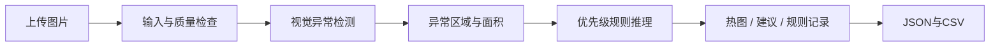

# 工业异常定位与可解释质量决策

**组员先读 [README_组员运行.md](README_组员运行.md)，课堂操作见 [README_演示.md](README_演示.md)。** 当前扩展为瓶口、金属螺母、瓷砖表面，每类提供特征记忆主模型与像素基线；合成垫圈只用于软件联调。源码、模型资产与运行环境分别交接。下面的 F 盘位置是原电脑路径，组员可使用自己的目录。

## 从 GitHub 获取并运行

公开仓库：[chinesecanfly99/foundation-ai-industrial-inspection](https://github.com/chinesecanfly99/foundation-ai-industrial-inspection)。任何人均可查看、克隆源码和下载 Release 附件，无需邀请；直接推送代码或参与仓库管理仍需相应权限。

```powershell
git clone https://github.com/chinesecanfly99/foundation-ai-industrial-inspection.git industrial-inspection
cd industrial-inspection
```

**三类扩展源码已同步到公开仓库，配套 [v0.2.0 Release](https://github.com/chinesecanfly99/foundation-ai-industrial-inspection/releases/tag/v0.2.0) 已发布。** 克隆或更新源码后，下载 [demo-assets-v0.2.0.zip](https://github.com/chinesecanfly99/foundation-ai-industrial-inspection/releases/download/v0.2.0/demo-assets-v0.2.0.zip)；将ZIP全部内容（包括 `models`、`.cache`、`samples`、`configs` 与资产清单）解压合并到项目根目录，再双击 `首次安装_Windows.cmd`，安装结束后双击 `start_windows.cmd`。资产包不包含环境与完整原始数据；原电脑也保留 `deliverables/demo-assets-v0.2.0.zip`。

[v0.1.0 历史版本](https://github.com/chinesecanfly99/foundation-ai-industrial-inspection/releases/tag/v0.1.0) 的旧附件只有瓶口与合成联调资产，不能完成三类演示；本轮请使用v0.2.0。也可按下文下载数据并重建模型。

本轮资产包已完成CRC及106个文件的SHA256校验，重复构建一致；在复制源码、无原始数据且禁止网络的隔离目录中，7个模型均完成后端单图推理。记录见 `results/three_products/package_verification.json`。这不等于第二台电脑或整个网页断网验收。

只想先检查界面时，可不下载模型附件：安装脚本会建立合成联调模型，在页面高级选项显示合成联调后使用。三类真实演示和评估仍需各自模型。以后更新源码运行 `git pull --ff-only`，只能取得已推送的改动；模型资产另行更新。

Foundation of AI 小组项目初稿。输入一张产品照片，输出异常位置、异常分数、质量建议、触发规则及可下载记录。

真实类别为 **MVTec AD bottle、metal_nut、tile**。各类分别只用正常图拟合，另用正常校准集确定阈值；保留各类全部官方测试图独立评估。创新研究点是将视觉异常与输入质量门控、区域规则、人工复核结合；其业务收益仍需独立标签验证。2026-10-20 的单瓶口结果为首轮历史，本轮三类证据以 `results/three_products/summary.json` 为准。

| 产品 | 演示内容 | 主模型 / 基线 |
| --- | --- | --- |
| 瓶口 | 正常、大块破损、小缺口、污染或异物 | `bottle_patch` / `bottle_pixel` |
| 金属螺母 | 正常、变形、颜色异常、翻面、划痕 | `metal_nut_patch` / `metal_nut_pixel` |
| 瓷砖表面 | 正常、裂纹、胶条残留、灰色划痕、油污、粗糙表面 | `tile_patch` / `tile_pixel` |

各模型的正常参考、阈值和模型卡独立；系统检测异常位置与分数，不自动命名缺陷类型，样例名称来自数据集标注。

本轮实际数据共 **974张**：正常训练527、正常校准132、独立测试315（75正常、240缺陷）；页面提供 **75张真实样例**（瓶口20、螺母25、瓷砖30），另6张合成图片供高级联调。详见 [当前状态](docs/STATUS.md)。

本轮本机自动测试 **93项通过**（0失败/错误/跳过，25.244秒），JUnit记录为 `results/three_products/tests.xml`。本机真实浏览器 **17项功能检查通过**，覆盖三类正常/缺陷、两模型、下载一致性、切换与错误恢复，记录为 `results/three_products/ui/ui_smoke.json`；这不是检测准确率或新电脑验收。

2026-10-26六模型完整测试已完成，主模型结果为：

| 产品 | 主模型图像AUROC | 冻结阈值缺陷召回 | 漏检 |
| --- | ---: | ---: | ---: |
| 瓶口 | 0.9921 | 79.37% | 13/63 |
| 金属螺母 | 0.9233 | 68.82% | 29/93 |
| 瓷砖表面 | 1.0000 | 94.05% | 5/84 |

主模型合计仍漏检 **47/240** 张缺陷图。AUROC衡量排序，不等于当前正常校准阈值下的召回；例如瓷砖AUROC=1仍有5例未越过冻结阈值。全部两模型对照、像素定位与失败记录见 `results/three_products/summary.json`、`comparison.csv`、`errors.csv`；不根据这些测试结果回调阈值。

## 在当前电脑直接演示

项目位于 `F:\Codex_file\Foudationai.groupwork`，已有独立 `.venv`。双击 **start_windows.cmd** 访问 **http://127.0.0.1:7860**；PyCharm 选择 **Industrial Inspection Local** 运行，访问 **http://127.0.0.1:7861**，详见 [PyCharm说明](README_PyCharm.md)。代码更新后需停止旧服务再启动，已运行进程不会自动切换代码。

1. 先选择产品类别，再选中文演示样例，默认使用该类别特征记忆主模型。
2. 点击“开始检测”，查看热图、分数与建议。
3. 展开规则记录，下载 JSON / CSV；再换正常、局部缺陷、黑图比较。
4. 同一图片可切换该类像素基线作对照；比较各自分数与各自阈值，不直接比较不同模型分数大小。
5. 合成样例默认隐藏，高级选项显示后匹配 `synthetic_pixel`，只用于软件联调。

如果端口被占用，可在项目目录运行：

```powershell
.\.venv\Scripts\python.exe -m app.app --port 7861
```

界面仅监听本机，不需要账号或外部 API。首次 CNN 拟合会下载官方 ResNet18 权重，缓存位于本项目 `.cache/torch/`；本机已经缓存后可重复使用。

## 规划和报告入口

- [执行规划索引](docs/README.md)：九主题与八阶段，沿用所提供 CV 规划的组织方式。
- [当前状态与证据](docs/STATUS.md)：已运行内容、待做实验、证据路径。
- [团队排期](docs/06_课程映射与团队排期.md)：相对六周与可合并六角色。
- [报告初稿](docs/report_draft.md)：方法、实验、实测表、局限和参考来源。
- [跨电脑交接](docs/09_跨电脑运行与交接.md)：组员换电脑后的复演顺序。
- [三类扩展执行规划](docs/10_三类扩展执行规划.md)：分产品数据、两模型、冻结教学策略与验收。

## 方法与实现



| 模块 | 首版实现 | 说明 |
| --- | --- | --- |
| 像素基线 | 正常图 RGB 均值/标准差残差 | 容易理解，对位置和光照敏感 |
| 局部特征模型 | 预训练 ResNet18 layer2/3、2048 项记忆库、最近邻距离 | 简化 PatchCore 风格，采用均匀采样，不是作者实现的完整复现 |
| 阈值 | 正常校准图最大图像分数×1.05；像素 q0.995×1.05 | 不用测试图选择阈值，不保证工业误报上界 |
| 图像分数 | 异常图最高 1% 像素分数的均值 | 分数不是缺陷概率 |
| 规则 | 输入质量优先、临界复核、区域与面积、兜底复核 | 按模型卡类别自动选 `configs/quality_rules*.json` 教学策略，未获行业验证 |
| 演示 | Gradio，本机运行、延迟加载模型 | 上传、样例、热图、逐条规则、下载 |

热图解释模型的视觉差异，规则记录解释处置建议；两者都不提供缺陷物理成因诊断。瓶口和螺母使用中央矩形示范关注区，瓷砖使用全图；不赋予未经标注的功能部位语义。各类政策在测试前冻结，没有独立业务处置标签。三类以外的产品及不同拍摄条件需要另行建模和验证。

页面 CSV 每次只导出当前图片的一行摘要，便于 Excel 整理；JSON 保存详细事实、逐条规则、产品/模型/策略与图片校验等元数据。两者不包含热图图片；批量实验的 `predictions.csv` 由命令行 `evaluate` 生成。

## 新电脑安装

推荐 Python **3.11**。不要复制其他电脑的 `.venv`。Windows 安装 Python 后，在项目目录运行：

```powershell
powershell -ExecutionPolicy Bypass -File .\setup_windows.ps1
.\start_windows.cmd
```

脚本仅为本次运行放宽执行策略，不修改系统策略。使用官方 CPU 版 torch 2.6.0 / torchvision 0.21.0 和 Gradio 5.49.1。当前实测精确依赖见 `requirements/lock-windows-cpu.txt`；`results/environment.json` 保存实际版本。现有其他 Python 环境保持独立。

macOS 提供 `bash setup_macos.sh` 和 `bash start_macos.command`，默认 CPU。**macOS 和第二台电脑尚未实机验收**。可选 GPU 路线需单独安装匹配的 torch/vision 与驱动后验证，不是当前 CPU 环境的必需项。

## 重现数据和实验

以下命令均从项目根目录执行，先激活环境（或把 `python` 换成 `.venv` 中的解释器）。

```powershell
.\.venv\Scripts\Activate.ps1
python -m industrial_inspection check-env
python -m industrial_inspection prepare-demo
python -m pytest -q --junitxml=results/tests.xml
```

真实数据保存在 `data/raw/mvtec_ad`。bottle 首轮约157 MB；新增螺母和瓷砖分别由通用脚本获取。脚本使用固定 revision 公开镜像，图像与掩码检查镜像 LFS SHA256/大小；这不等于验证过官方完整归档。来源见各类 `source.json` 与清单 summary。已有模型资产只做演示时，不必重复训练。

```powershell
python scripts/download_bottle.py
python scripts/download_mvtec.py --category metal_nut
python scripts/download_mvtec.py --category tile
foreach ($product in @("bottle", "metal_nut", "tile")) {
    python -m industrial_inspection prepare --data-root data/raw/mvtec_ad --category $product --output "data/manifests/$product.csv"
    python -m industrial_inspection train --manifest "data/manifests/$product.csv" --method pixel --model-dir "models/${product}_pixel"
    python -m industrial_inspection train --manifest "data/manifests/$product.csv" --method patch --model-dir "models/${product}_patch"
    python -m industrial_inspection evaluate --manifest "data/manifests/$product.csv" --model-dir "models/${product}_pixel" --output "results/my_run/${product}_pixel"
    python -m industrial_inspection evaluate --manifest "data/manifests/$product.csv" --model-dir "models/${product}_patch" --output "results/my_run/${product}_patch"
}
python scripts/prepare_samples.py --categories bottle metal_nut tile --per-type 5
```

首轮 bottle 划分：正常训练 **167**、正常校准 **42**、独立测试 **83**（正常20、缺陷63）。三类最新数量读取各类 `data/manifests/<类别>.summary.json` 和 `results/three_products/summary.json`。内容哈希检查精确重复，数据未提供真实产品 ID，因此无法完全排除同一产品的不同照片。模型、阈值、清单和策略应先冻结再测试，不以 test 结果反复选参。上述命令会更新指定模型和清单，正式版本须先留存。

评估目录中有 `metrics.json`、逐图 `predictions.csv`、模型卡快照。像素指标按 **128×128** 计算 pooled AUROC 与异常图均值 IoU/Dice，不能直接当成官方全分辨率基准成绩。正式结论应包含失败案例，不只展示最好的图片。

单图与规则推理：

```powershell
python -m industrial_inspection predict --image samples/bottle/broken_large_000.png --model-dir models/bottle_patch --output results/example_bottle
```

默认根据模型卡类别自动选政策。可用 `--rules` 显式指定自定义策略；带类别策略与模型冲突会拒绝，未知来源模型须明确提供规则。目录若已有同名输出会更新它；保留正式研究版本时为每次运行指定不同目录。

## 项目目录

```text
app/app.py                     中文演示页面
src/industrial_inspection/      数据、检测器、规则、推理、评估与CLI
configs/quality_rules*.json    分类别、带版本的教学规则
scripts/                       数据下载、浏览器验收等
tests/                         数据隔离、检测器、规则和输入边界检查
requirements/                  基础依赖、平台依赖和本机锁定版本
docs/                          完整执行规划、阶段任务、状态和报告
data/manifests/                 CSV清单、内容hash和划分摘要
models/<model>/                数值NPZ模型和JSON模型卡（不入Git）
.cache/torch/                  官方预训练权重缓存（不入Git）
samples/                       演示图片与来源说明
results/                       指标、逐图结果、环境与验收证据
```

原始数据、环境、模型与权重不提交 Git；当前 F 盘保留它们以便直接演示。新电脑可按命令重新生成或另外复制模型及缓存。保存模型使用数值 NPZ（`allow_pickle=False`）和校验哈希；页面不接受上传任意模型文件。

浏览器验收脚本为 `scripts/test_three_products_browser.py`；`scripts/test_ui_browser.py` 保留为同一验收入口。先启动本地界面，再在另一个终端运行（本机使用已安装的 Edge，无需再下载浏览器）：

```powershell
python -m pip install -r requirements/browser-test.txt
python scripts/test_three_products_browser.py --base-url http://127.0.0.1:7861 --browser-executable "C:\Program Files (x86)\Microsoft\Edge\Application\msedge.exe"
```

该脚本检查三类真实产品的正常/缺陷上传、主模型与像素基线、产品/政策对应、热图与报告一致性，以及空图、小图、黑图、高级合成联调和窄屏显示。默认连接 PyCharm 的7861；使用启动脚本的7860时，将 `--base-url` 改为 `http://127.0.0.1:7860`。实际通过状态与检查范围以 `results/three_products/ui/ui_smoke.json` 为准，见 [验收文档](docs/05_部署与演示验收.md)。浏览器功能验收不代替完整真实测试集评估。历史33项自动测试和9项浏览器检查来自首轮，本轮状态见 STATUS；GitHub Actions 状态以远程仓库为准。

## 后续优先任务

1. 补齐课程正式评分表、组员与截止时间，认领阶段任务。
2. 固定实验版本后做光照/模糊扰动、记忆库预算消融及更多随机种子。
3. 对模拟质量处置独立标注，再比较纯分数策略与规则策略的错误放行、复核负担。
4. 做第二台电脑与断网复演，完成最终报告、PPT和演示录屏。

## 来源与数据使用

本项目是独立撰写的课程原型，参考 [PatchCore 作者代码](https://github.com/amazon-science/patchcore-inspection)、[Anomalib](https://github.com/open-edge-platform/anomalib) 的研究路线与数据格式，没有把现成项目性能当成本项目成绩。预训练骨干使用 [torchvision ResNet18](https://docs.pytorch.org/vision/0.21/models/generated/torchvision.models.resnet18.html)。

[MVTec AD](https://www.mvtec.com/research-teaching/datasets/mvtec-ad) 原始数据由 MVTec Software GmbH 发布，遵循 **CC BY-NC-SA 4.0**，用于非商业课程研究；镜像为 [foersben/mvtec-ad](https://huggingface.co/datasets/foersben/mvtec-ad)。真实样例沿用原数据许可，详情见 `samples/README.md`。合成图仅为联调生成。
