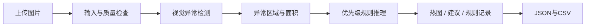

# 工业异常定位与可解释质量决策

**组员先读 [README_组员运行.md](README_组员运行.md)。** GitHub 克隆包含源码和样例；真实瓶类演示需另外下载下方模型附件。完整转发包已带模型和骨干缓存。下面的 F 盘位置是原电脑路径，组员可使用自己的目录。

## 从 GitHub 获取并运行

公开仓库：[chinesecanfly99/foundation-ai-industrial-inspection](https://github.com/chinesecanfly99/foundation-ai-industrial-inspection)。任何人均可查看、克隆源码和下载 Release 附件，无需邀请；直接推送代码或参与仓库管理仍需相应权限。

```powershell
git clone https://github.com/chinesecanfly99/foundation-ai-industrial-inspection.git industrial-inspection
cd industrial-inspection
```

打开 [v0.1.0 下载页](https://github.com/chinesecanfly99/foundation-ai-industrial-inspection/releases/tag/v0.1.0)，下载 `demo-assets-v0.1.0.zip`，将其中的 `models`、`.cache`、`samples` 解压到当前项目根目录。然后双击 `首次安装_Windows.cmd`，安装结束后双击 `start_windows.cmd`。

只想先检查界面时，可不下载模型附件：安装脚本会执行 `prepare-demo`，生成合成联调数据与 `synthetic_pixel` 模型。真实 bottle 演示和模型评估仍需要对应模型。以后更新源码，在项目目录运行 `git pull --ff-only`；模型版本更新时另外更新附件。

Foundation of AI 小组项目初稿。输入一张产品照片，输出异常位置、异常分数、质量建议、触发规则及可下载记录。

首个真实类别为 **MVTec AD bottle**。模型只用正常图拟合，另用正常校准集确定阈值；保留全部官方测试图做独立评估。创新研究点是将视觉异常与输入质量门控、区域规则、人工复核结合；其业务收益仍需独立标签验证。

## 在当前电脑直接演示

项目位于 `F:\Codex_file\Foudationai.groupwork`，已有独立 `.venv`，双击 **start_windows.cmd**，然后访问 **http://127.0.0.1:7860**。

1. 选择一张 `MVTec bottle` 样例，检查模型为 `bottle_patch`。
2. 点击“开始检测”，查看热图、分数与建议。
3. 展开规则记录，下载 JSON / CSV；再换正常、局部缺陷、黑图比较。
4. 合成样例会自动匹配 `synthetic_pixel`，只用于软件联调。

如果端口被占用，可在项目目录运行：

```powershell
.\.venv\Scripts\python.exe -m app.app --port 7861
```

界面仅监听本机，不需要账号或外部 API。首次 CNN 拟合会下载官方 ResNet18 权重，缓存位于本项目 `.cache/torch/`；本机已经缓存后可重复使用。

## 规划和报告入口

- [执行规划索引](docs/README.md)：九主题与八阶段，沿用所提供 CV 规划的组织方式。
- [当前状态与证据](docs/STATUS.md)：已运行内容、待做实验、证据路径。
- [团队排期](docs/06_课程映射与团队排期.md)：相对六周与可合并六角色。
- [报告初稿](docs/report_draft.md)：方法、实验、实测表、局限和参考来源。
- [跨电脑交接](docs/09_跨电脑运行与交接.md)：组员换电脑后的复演顺序。

## 方法与实现



| 模块 | 首版实现 | 说明 |
| --- | --- | --- |
| 像素基线 | 正常图 RGB 均值/标准差残差 | 容易理解，对位置和光照敏感 |
| 局部特征模型 | 预训练 ResNet18 layer2/3、2048 项记忆库、最近邻距离 | 简化 PatchCore 风格，采用均匀采样，不是作者实现的完整复现 |
| 阈值 | 正常校准图最大图像分数×1.05；像素 q0.995×1.05；通过面积门槛为校准 p90×1.2 且上限 0.005 | 不用测试图选择阈值，校准只能收紧，不保证工业误报上界 |
| 图像分数 | 异常图最高 1% 像素分数的均值 | 分数不是缺陷概率 |
| 规则 | 强拒收证据优先、输入门控与画质门控、临界复核、区域与面积、兜底复核 | `configs/quality_rules.json` 为教学策略，未获行业验证 |
| 演示 | Gradio，本机运行、延迟加载模型 | 上传、样例、热图、逐条规则、下载 |

热图解释模型的视觉差异，规则记录解释处置建议；两者都不提供缺陷的物理成因诊断。固定区域仅为归一化演示矩形，不赋予未经标注的瓶口/瓶身语义。模型只适用于固定工位、与训练图同样构图和光照的瓶子俯拍图；当前类别以外的产品及不同拍摄条件需要重新建模。

## 新电脑安装

推荐 Python **3.11**。不要复制其他电脑的 `.venv`。Windows 安装 Python 后，在项目目录运行：

```powershell
powershell -ExecutionPolicy Bypass -File .\setup_windows.ps1
.\start_windows.cmd
```

脚本仅为本次运行放宽执行策略，不修改系统策略。当前依赖为 torch 2.14.1 / torchvision 0.29.1、Gradio 6.30.0、Pillow 12.3.0；Windows 旧锁文件（gradio 5.49.1 / torch 2.6.0+cpu）已移入 `requirements/history/lock-windows-cpu-v0.1.txt`，仅作历史记录、不得用于安装，需按 `requirements/base.txt` 重装。`results/environment.json` 保存本次实际版本。现有其他 Python 环境保持独立。

macOS 提供 `bash setup_macos.sh` 和 `bash start_macos.command`，默认 CPU。**macOS 和第二台电脑尚未实机验收**。可选 GPU 路线需单独安装匹配的 torch/vision 与驱动后验证，不是当前 CPU 环境的必需项。

## 重现数据和实验

以下命令均从项目根目录执行，先激活环境（或把 `python` 换成 `.venv` 中的解释器）。

```powershell
.\.venv\Scripts\Activate.ps1
python -m industrial_inspection check-env
python -m industrial_inspection prepare-demo
python -m pytest -q --junitxml=results/tests.xml
```

真实数据只下载 bottle，约 157 MB，保存在 `data/raw/mvtec_ad`。旧官方下载地址在本次访问时返回 404，因此脚本使用公开镜像并固定镜像 revision，检查每个文件的大小和镜像 LFS SHA256；这不等于验证过官方完整归档。来源见 `data/raw/mvtec_ad/source.json` 及清单 summary。

```powershell
python scripts/download_bottle.py
python -m industrial_inspection prepare --data-root data/raw/mvtec_ad --category bottle --output data/manifests/bottle.csv
python -m industrial_inspection train --manifest data/manifests/bottle.csv --method pixel --model-dir models/bottle_pixel
python -m industrial_inspection train --manifest data/manifests/bottle.csv --method patch --model-dir models/bottle_patch
python -m industrial_inspection calibrate-policy --manifest data/manifests/bottle.csv --model-dir models/bottle_patch --output configs/calibration/bottle.json
python -m industrial_inspection calibrate-policy --manifest data/manifests/bottle.csv --model-dir models/bottle_pixel --output configs/calibration/bottle.json
python -m industrial_inspection evaluate --manifest data/manifests/bottle.csv --model-dir models/bottle_pixel --output results/bottle_pixel
python -m industrial_inspection evaluate --manifest data/manifests/bottle.csv --model-dir models/bottle_patch --output results/bottle_patch
```

当前划分：正常训练 **167**、正常校准 **42**、独立测试 **83**（正常20、缺陷63）。内容哈希检查精确重复，数据未提供真实产品 ID，因此无法完全排除同一产品的不同照片。模型、阈值、清单和策略应先冻结再测试，不以 test 结果反复选参。

评估目录中有 `metrics.json`、逐图 `predictions.csv`、模型卡快照。像素指标按 **128×128** 计算 pooled AUROC 与异常图均值 IoU/Dice，不能直接当成官方全分辨率基准成绩。正式结论应包含失败案例，不只展示最好的图片。

单图与规则推理：

```powershell
python -m industrial_inspection predict --image samples/bottle/broken_large_000.png --model-dir models/bottle_patch --output results/example_bottle
```

目录若已有同名输出会更新它；保留正式研究版本时为每次运行指定不同目录。

## 项目目录

```text
app/app.py                     中文演示页面
src/industrial_inspection/      数据、检测器、规则、推理、评估与CLI
configs/quality_rules.json     带版本的演示规则
scripts/                       数据下载、浏览器验收等
tests/                         数据隔离、检测器、规则和输入边界检查
requirements/                  基础依赖、平台依赖和本机锁定版本（历史快照在 requirements/history/）
docs/                          完整执行规划、阶段任务、状态和报告
data/manifests/                 CSV清单、内容hash和划分摘要
models/<model>/                数值NPZ模型和JSON模型卡（不入Git）
.cache/torch/                  官方预训练权重缓存（不入Git）
samples/                       演示图片与来源说明
results/                       指标、逐图结果、环境与验收证据
```

原始数据、环境、模型与权重不提交 Git；当前 F 盘保留它们以便直接演示。新电脑可按命令重新生成或另外复制模型及缓存。保存模型使用数值 NPZ（`allow_pickle=False`）和校验哈希；页面不接受上传任意模型文件。

浏览器验收脚本为 `scripts/test_ui_browser.py`。先启动本地界面，再在另一个终端运行（本机使用已安装的 Edge，无需再下载浏览器）：

```powershell
python -m pip install -r requirements/browser-test.txt
python scripts/test_ui_browser.py --browser-executable "C:\Program Files (x86)\Microsoft\Edge\Application\msedge.exe"
```

该脚本检查合成正常/异常与黑图的上传、热图、规则、报告下载和窄屏布局；实际范围与通过状态写入 `results/ui_smoke.json`。它不代替83张真实测试图的模型评估。仓库已配置 GitHub Actions，远程运行状态以仓库 Actions 页面为准；已保存的33项通过记录来自本机测试。

## 后续优先任务

1. 补齐课程正式评分表、组员与截止时间，认领阶段任务。
2. 固定实验版本后做光照/模糊扰动、记忆库预算消融及更多随机种子。
3. 对模拟质量处置独立标注，再比较纯分数策略与规则策略的错误放行、复核负担。
4. 做第二台电脑与断网复演，完成最终报告、PPT和演示录屏。

## 来源与数据使用

本项目是独立撰写的课程原型，参考 [PatchCore 作者代码](https://github.com/amazon-science/patchcore-inspection)、[Anomalib](https://github.com/open-edge-platform/anomalib) 的研究路线与数据格式，没有把现成项目性能当成本项目成绩。预训练骨干使用 [torchvision ResNet18](https://docs.pytorch.org/vision/0.21/models/generated/torchvision.models.resnet18.html)。

[MVTec AD](https://www.mvtec.com/research-teaching/datasets/mvtec-ad) 原始数据由 MVTec Software GmbH 发布，遵循 **CC BY-NC-SA 4.0**，用于非商业课程研究；镜像为 [foersben/mvtec-ad](https://huggingface.co/datasets/foersben/mvtec-ad)。真实样例沿用原数据许可，详情见 `samples/README.md`。合成图仅为联调生成。
