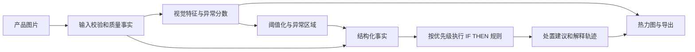

# 02 项目定义与总流程

## 题目与实际用途

中文题目：**工业产品异常定位与可解释质量决策辅助系统**。

英文题目：**Industrial Anomaly Localization and Explainable Quality Decision Support**。

系统帮助模拟外观质检人员检查产品图片：指出哪些区域偏离正常外观，再按预先定义的规则给出“通过、人工复核、拒收建议、无法判定（建议重拍）”。这些均为课程模拟处置建议。首个产品类别是公开数据中的 bottle，输出不直接控制真实出厂、报废或安全决定。

例子：上传瓶子图片后，系统显示原图与异常热力图；若图片过暗，先建议重新拍摄；若异常分数临界，转人工复核；若候选异常落在设定关注区，显示对应规则与测量值。关注区必须与当前数据视角一致，不能把 bottle 俯视图中任意上方区域叫作瓶口。

## 核心研究问题

1. 使用正常样本构建的局部特征记忆库，相比简单像素参考基线，在 bottle 异常识别与定位上表现如何？
2. 在冻结检测模型后，输入质量门控、区域规则和复核机制能否减少错误放行？由此增加多少复核或重拍负担？
3. 亮度变化、模糊等受控扰动会怎样影响结果与解释？CPU 推理能否满足课堂单图交互？

问题 2 必须有事先定义且独立标注的处置标签才能回答。若该标签未完成，只能报告规则一致性与覆盖率，不能宣布“质量决策准确率提高”。

## 输入输出与知识表示

输入为单张产品图片、已拟合模型及固定配置。输出包含异常分数、热力图、候选异常掩码、区域面积、输入质量事实、规则编号、触发测量值与建议状态。

示例推理链：`图像可用 → 异常分数超过正常校准阈值 → 候选异常与关注区重叠 → 触发拒收建议或人工复核规则`。低质量输入优先，避免继续把模糊造成的异常当成确定产品缺陷。初稿采用首个匹配规则胜出，仍保存各规则条件及选中状态；具体阈值和规则 ID 以仓库配置为准。

## 范围与交付

| 必做 | 完成定义 |
| --- | --- |
| 一个产品类别 | bottle 数据来源、清单、掩码与划分可追溯 |
| 两个检测方案 | 像素参考基线与 CNN 局部记忆库，同协议评估 |
| 独立校准 | 正常训练与正常校准分开，测试不调参 |
| 规则推理 | 输入质量、异常程度、关注区等事实可追踪；冲突优先级明确 |
| 演示闭环 | 图片输入、热力图、建议、解释和结果导出 |
| 实验与限制 | 检测/定位/复核/性能分开评估，含误检漏检 |
| 可复演 | 独立环境和另一台目标电脑按文档操作 |

可选扩展为第二个产品类别、正式 Anomalib PatchCore 对照、多随机种子、更多真实图片、摄像头或批量检查。生产线接入、缺陷物理成因诊断、医疗或安全认证、云端托管不是初稿必做项。

## 研究创新的表述

本项目的候选贡献是“异常定位与可追踪规则决策的结合及其对照评估”。先提供有依据的规则与复核机制，再用数据检验其效果。不要把调用预训练模型、画热力图或加入文字说明分别包装成原创算法。若改进未提高指标，也应报告造成误差的样例与条件。

## 六周推进

第 1 周明确范围并跑通；第 2 周冻结数据与基线；第 3 周完成 CNN 模型和阈值；第 4 周做规则、扰动与对照；第 5 周复演和失效分析；第 6 周定稿与排练。详细角色和里程碑见 [06](06_课程映射与团队排期.md)。
