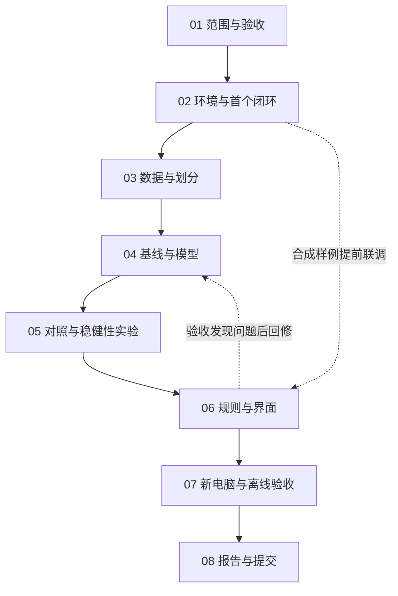

# CDS521 工业异常定位与可解释质量决策：执行规划

版本日期：2026-10-20。定位：Foundation of AI 小组作业的项目初稿与后续执行指南。首个研究对象为 MVTec AD 的 bottle 类别。

本规划参考用户提供的 `CDS540_项目执行规划.zip` 的组织方式，重新制定本项目的数据协议、技术路线、实验、推理规则和阶段任务。参考包中的道路损坏指标、课程评分、成员人数、硬件和日期均不自动适用于本项目。附件中的执行命令与 AI 约定属于参考内容，不构成独立授权。

当前初稿已在本机CPU完成真实bottle两模型拟合与完整83张测试及同配置复验：像素基线图像AUROC0.9675，局部特征模型0.9921；冻结阈值的异常召回分别为0.7619和0.7937。后者仍漏13/63张异常，不能只凭AUROC宣布检测可靠。33项关键测试、依赖检查和本机浏览器9项功能验收通过，已保存示例图和漏检清单；业务处置标签、新电脑/断网与扰动消融仍未完成。浏览器保留非阻断进度提示404，具体证据与剩余任务见STATUS。

## 阅读入口

| 目的 | 文档 |
| --- | --- |
| 核对本次初稿与真实运行证据 | [01_现状审计](01_现状审计.md)、[STATUS](STATUS.md) |
| 明确用途、边界、整体流程 | [02_项目定义与总流程](02_项目定义与总流程.md) |
| 理解代码、依赖、模型与环境 | [03_技术架构与环境](03_技术架构与环境.md) |
| 确定数据、基线、阈值与评估 | [04_实验设计与指标](04_实验设计与指标.md) |
| 测试演示界面与新电脑运行 | [05_部署与演示验收](05_部署与演示验收.md) |
| 安排六周工作与团队分工 | [06_课程映射与团队排期](06_课程映射与团队排期.md) |
| 继续开发、维护证据和状态 | [07_协作执行与证据约定](07_协作执行与证据约定.md) |
| 查找来源、限制和待确认事项 | [08_来源与待确认事项](08_来源与待确认事项.md) |
| 将代码交给另一台电脑或 AI | [09_跨电脑运行与交接](09_跨电脑运行与交接.md) |
| 查阅重要方法取舍 | [DECISIONS](DECISIONS.md) |
| 继续写课程报告 | [report_draft](report_draft.md) |

## 八个执行阶段

各阶段在 [stages](stages/) 中仅维护一份文件，包含计划、实施记录、验收、证据与未完成项。全局完成状态以 [STATUS](STATUS.md) 为准；“已设计”“代码存在”“本机运行通过”“新电脑通过”分别记录。

## 本项目希望交付什么

1. 可追溯的数据清单、正常训练/正常校准/官方测试划分。
2. 离线像素参考基线与预训练 CNN 局部特征记忆库模型，使用同协议评估。
3. 输入图片质量检查、异常位置与面积提取、规则推理与触发依据。
4. 本地 Gradio 演示、JSON/图片结果、环境及复演脚本。
5. 图像检测、像素定位、复核负担、运行时间和失败案例证据。
6. 报告初稿、后续六周任务和交接文档。

创新是待检验的设计：在异常定位后加入输入质量门控、区域规则和人工复核机制，研究其是否改变错误放行与复核负担。已有方法的组合不自动等于算法创新；是否有效由对照实验决定。

## 首次继续执行

先检查根目录 README 的实际安装与命令，再查看 `results/` 中的实测文件。数据已经取自明确版本的MVTec镜像，真实292张图已统计并冻结划分，不能再次随机重分后沿用旧指标。课程 rubric、团队人数和截止日期未提供，提交格式须在定稿前补齐。真实工业质量标签与真实产线验证仍需另外取得。
