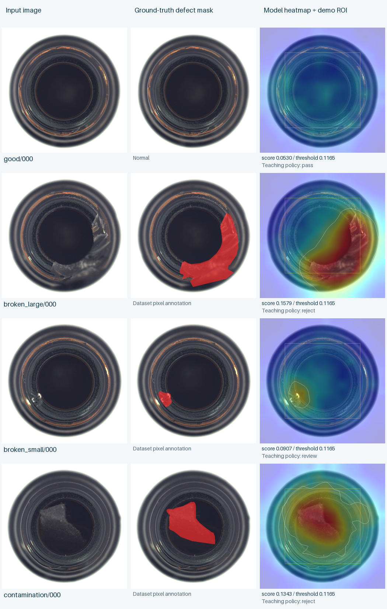

# 工业产品异常定位与可解释质量决策辅助系统

**Industrial Anomaly Localization and Explainable Quality Decision Support**

课程：Foundation of AI / CDS521（正式课程名、组号、成员与格式待核对）  
文档状态：2026-10-26三类扩展初稿。六模型已对三类315张独立测试图完成评估，数据与结果核对自 `results/three_products/summary.json`（complete=true、6有效模型）；本轮93项自动测试、17项浏览器功能检查与资产隔离后端禁网推理已通过；源码已推送GitHub，配套 [v0.2.0资产](https://github.com/chinesecanfly99/foundation-ai-industrial-inspection/releases/tag/v0.2.0) 已发布，远程大小和SHA256与本机一致；远程CI另行查看，不等同本机测试。2026-10-20单瓶口首轮数据与83图成绩保留为历史。规则业务有效性、扰动/消融、新电脑和最终课程提交尚未完成。

## 摘要

本项目研究仅使用正常产品图像建立异常检测器，并将视觉异常转换为可追踪的教学质量建议。研究范围由瓶口扩展到金属螺母和瓷砖表面，覆盖物体结构与表面纹理。三类共974张真实图片，其中527张正常图拟合、132张正常图校准，315张官方测试图保持独立；每类比较像素参考基线与预训练ResNet18的简化局部特征记忆库。三类图像AUROC宏平均由0.8020提升到0.9718，但特征模型在冻结正常校准阈值下仍漏47/240张缺陷，螺母召回仅0.6882，不能以高AUROC声称零漏检。类别对应教学策略结合图像质量、异常面积与示范关注区域，保留逐条规则；尚无独立业务处置标签，不能据此宣称真实出厂决策有效。稳健性实验、新电脑复演和最终课程提交仍待完成。

### 首轮单瓶口摘要（2026-10-20历史）

工业外观质检中的缺陷种类可能多样，而缺陷样本收集和逐类标注成本较高。本项目研究仅使用正常产品图像建立异常检测器，并将其输出转换为可追踪的质量决策建议。以MVTec AD bottle为首类，使用167张正常图拟合、42张正常图校准，并在83张官方测试图上比较像素参考基线与CNN局部特征记忆库。图像AUROC分别为0.9675和0.9921，冻结正常阈值后的异常召回分别为0.7619和0.7937。CNN排序能力较好，但仍漏13/63张异常图，小破损检出也低于像素基线。规则层结合图像质量、异常程度、候选面积与关注区域，输出模拟处置建议并记录触发依据；其业务有效性尚未获得独立处置标签验证。本机CPU完成环境、33项关键测试及模型评估，后续需完成规则对照、扰动/消融和新电脑复演。

关键词：工业异常检测；正常样本学习；局部特征；知识表示；规则推理；人工复核。

## 1 引言与研究问题

仅凭产品图片确定最终质量结论存在两个不同任务：首先识别外观是否偏离正常模式，其次判断该偏离应触发什么处置。异常分数高不必然代表严重缺陷，低质量图片也可能使视觉模型产生误报。因此，本项目将视觉感知与透明规则推理结合，研究一个便于课程解释和演示的质量辅助系统。

用户为模拟质检人员，输入是单张产品图片，输出为异常可视化、结构化事实及处置建议。系统不控制真实生产线，也不根据图片宣布产品安全、解释材料失效成因或获得行业认证。重点在于正确建立实验协议，说明模型与规则各自的作用，并诚实呈现失败情况。

研究问题为：

- RQ1：预训练局部特征记忆库相较像素参考基线，在瓶口、金属螺母、瓷砖三类独立测试上是否改善异常识别与像素定位？改善是否对所有类别和缺陷类型一致？
- RQ2：固定同一个检测模型后，加入输入质量门控、区域规则和人工复核机制，对错误放行与复核比例有何影响？
- RQ3：受控亮度、模糊扰动如何影响上述结果？CPU 运行是否能够完成课堂单图交互？

RQ2 需要独立模拟处置标签；如果未取得，该部分仅能报告规则实现一致性与触发分布，不声称业务效果提高。

## 2 背景与相关工作

### 2.1 正常样本异常检测

正常样本学习通过建立正常外观的表示，使用新图像与该表示之间的差异产生异常分数。它适合研究缺陷类型不完全已知的情形，但“偏离正常”仍可能来自光照、位置或拍摄条件变化。

MVTec AD 是工业视觉异常检测的常用公开基准，提供正常训练样本、正常和缺陷测试样本及像素标注。本项目首轮以 bottle 验证闭环，本轮增加 metal_nut 和 tile；三类仍不代表全部工业材料或真实产线。[1]

### 2.2 局部特征记忆库

PatchCore 以预训练特征构建正常局部表示记忆，并利用近邻差异识别异常。[2] 本项目借鉴这一思路实现规模可控的教学模型，强调 CPU 可运行、模型保存与解释接口。若没有采用作者实现中的全部特征处理、coreset 与打分细节，统一称为“简化局部特征记忆库”，不称为官方 PatchCore 的忠实复现。官方论文性能不作为本项目实测结果。

Anomalib 可用于未来正式算法对照与统一训练评估，但初稿独立实现最小方法，以便小组理解特征距离、记忆库与阈值的关系。[3]

### 2.3 知识表示与规则推理

视觉输出转换为事实，例如 `quality_ok`、`anomaly_score`、`candidate_area_ratio` 和 `region_overlap`。规则根据事实及固定阈值产生建议。通过显示规则 ID、条件和测量值，系统可以说明“为什么按这套规则得出该建议”。这属于决策过程解释，不能与缺陷物理成因解释混同。

## 3 方法

### 3.1 整体架构

流程为：输入校验 → 图像质量检查 → 视觉异常评分 → 候选区域提取 → 结构化事实 → 优先级规则推理 → 原图、热力图、解释与结果导出。命令行、评估程序与 Gradio 调用同一个推理核心，使用相同配置。

### 3.2 像素参考基线 B01

对正常训练图片建立按位置的参考统计，并由新图与参考之间的偏离形成异常图。具体统计、归一化与图像级聚合以模型卡记录。这一基线易于离线运行，但对图像对齐和光照敏感；它为判断 CNN 特征的价值提供简单对照。

### 3.3 局部特征模型 M01

初稿使用 torchvision ResNet18 `IMAGENET1K_V1` 的 layer2/layer3 特征，经局部平均、上采样对齐与拼接得到 384 维局部表示。以固定 seed 进行均匀随机优先级采样，默认记忆库预算为 2,048 个特征。推理时取最近欧氏距离并除以特征维度平方根，得到局部异常分数，再映射回图像空间。模型默认输入128×128，实际配置以模型卡为准。模型拟合主要是记忆库构建，CNN不微调。

保存骨干版本及预训练权重来源、输入尺寸、特征层、采样方式、seed、记忆库大小、距离度量和聚合定义。若骨干下载失败，程序明确报错，不以随机权重替代正式预训练模型。

### 3.4 校准与区域提取

正常训练样本不同时充当阈值校准样本。图像分数定义为异常图最高1%像素均值；图像阈值取正常校准图像分数最大值×1.05，像素阈值取正常校准图在模型坐标下的像素分数q0.995×1.05，两者最低为1e-6。官方测试集及缺陷掩码不参与阈值选择。该正常校准启发式不提供生产误报率保证。

阈值化得到候选区域，并计算面积比例与关注区重叠。掩码使用明确坐标与插值规则。异常分数是距离或偏离量，不直接解释为缺陷概率。显示色阶与决策尺度分开，避免每图独立归一化导致颜色不可比较。

### 3.5 规则与解释

规则优先级首先处理无法可靠判读的图片，再处理异常与复核。例如：

| 条件示例 | 建议 | 解释依据 |
| --- | --- | --- |
| 图片过暗或明显模糊 | 重新拍摄 | 质量测量值及阈值 |
| 分数接近阈值 | 人工复核 | 分数、临界区间 |
| 异常与关注区显著重叠 | 人工复核或不通过建议 | 异常区域、重叠比例、规则 |
| 当前冻结阈值下未触发异常条件 | 通过建议 | 当前模型与阈值；保留局限说明 |

这张表是方法示意，不替代代码中的版本化规则。关注区需根据实际拍摄视角制定，不臆造瓶口/瓶身语义。规则参数如用于研究改进，应在正式测试前冻结。

本轮路由按模型卡 `dataset_source` 选择注册策略。瓶口沿用既有规则，螺母使用中央归一化示范矩形，瓷砖使用全图关注区；其余规则门槛与旧协议一致，在查看新类测试成绩前冻结。区域没有独立功能部位标注，不代表螺纹、承力区或瓷砖等级标准。显式指定的带类别策略与模型不匹配时拒绝推理，避免将瓶口政策套给瓷砖。

## 4 数据与实验设计

### 4.1 三类数据协议与支持数

| 类别 | 正常拟合 | 正常校准 | 官方test正常 | 官方test缺陷 | 总数 | 演示样例 |
| --- | ---: | ---: | ---: | ---: | ---: | ---: |
| bottle 瓶口 | 167 | 42 | 20 | 63 | 292 | 20 |
| metal_nut 金属螺母 | 176 | 44 | 22 | 93 | 335 | 25 |
| tile 瓷砖表面 | 184 | 46 | 33 | 84 | 347 | 30 |
| 合计 | 527 | 132 | 75 | 240 | 974 | 75 |

每类分别从官方正常训练图按精确内容组留出20%校准，seed42；正常拟合、正常校准、官方test相互隔离。新两类清单未发现精确内容重复；不排除近重复或同实物不同照片。`data/manifests/<类别>.summary.json` 保存来源与支持数，`samples/samples.json` 保存演示选图来源及哈希。演示图按每种类型排序前5张选择，不按模型得分挑最好案例；另6张合成联调不参与正式结果。

以下数据来源表保留首轮瓶口原始记录；新增两类来源、文件核验和大小以各自 `source.json` 为准。下载器固定同一镜像revision，检查镜像文件哈希与大小，不等于核验原站完整归档。

从官方 `train/good` 留出约 20% 为正常校准，其余用于拟合；官方 test 原样保留。使用固定 seed、相对路径和内容哈希保存清单；检查重复、图片/掩码配对及尺寸。若数据来自镜像，报告镜像来源与能完成的完整性检查，不声称已验证官方归档哈希。

| 数据项目 | 实测填写来源 | 当前报告状态 |
| --- | --- | --- |
| 实际来源/归档哈希 | 下载记录、数据卡 | foersben/mvtec-ad镜像固定revision；357文件/156,570,806字节；校验镜像LFS哈希/大小，未核验官方完整归档哈希 |
| 正常训练/校准数量 | `data/manifests/bottle.summary.json` | 167训练、42校准，seed42 |
| 测试正常/缺陷与类型数量 | 同上及bottle.csv | 83张：good20、broken_large20、broken_small22、contamination21 |
| 重复和配对检查 | QA、metrics data_validation | 292图、63异常掩码验证；292个不同精确RGB内容组，无精确重复；不保证无近重复/同实物 |
| 清单版本/哈希 | summary、模型卡 | SHA256 `e91d0a6b4c17ebc1e9fa9be41dbd64e94278011067b73411d6f1e2805274217a` |

镜像revision为 `c75b39616f84db43677bcc8228caaafaf5096d7f`。旧官方归档链接在本次获取时返回404，镜像不是原发布者归档校验的替代证明；许可与原数据引用保持不变。

### 4.2 实验设置

B01/M01 使用同一划分与评估清单。初稿完成像素与 CNN 两条路线；扩展实验包括不同记忆库预算、亮度/模糊扰动及多 seed。模型、阈值和规则先冻结，再运行正式测试；测试结果不用于反复挑选参数。

| 设置 | 结果应引用 |
| --- | --- |
| Python、系统、torch/vision、CPU | `results/environment.json` |
| 输入尺寸、骨干、特征、记忆库 | 对应 `model_card.json` |
| 正常校准分位数与阈值 | 同上与解析配置 |
| 代码提交、清单与规则哈希 | 实验元数据 |

首轮历史运行环境为Windows11 build22631、Python3.11.1、torch2.6.0+cpu、torchvision0.21.0+cpu、Gradio5.49.1，CPU20逻辑线程，模型计算限制为最多4个torch线程。首轮两模型输入128×128，M01实际记忆库2,048个384维特征。bottle的B01图像/像素阈值为4.480851/2.874204，M01为0.116518/0.074309；这些数值不能用于螺母/瓷砖，各类确切值见模型卡，不以舍入值重新拟合。

### 4.3 评价指标

图像层报告 AUROC 和固定阈值的 Precision/Recall/F1、混淆矩阵与正常误报率；定位层当前将预测图/掩码统一为128×128，报告跨图像像素合并的 AUROC 和异常图平均 IoU/Dice。该结果不是官方全分辨率评估或 AUPRO；正常图误报面积留待扩展。业务处置层仅在独立标签具备后报告错误放行、复核比例、重拍比例与自动处置覆盖率。运行层初稿报告一次热身和热身后推理p50/p95；完整链路及均值留待扩展，计时边界需明确。

处置标签由预先制定的模拟业务协议和独立人工标注产生，不能使用被评规则自动生成真值。合成亮度/模糊扰动不代表真实产线新域验证；被质量门控拒绝的输入仍计入端到端结果。

## 5 三类扩展与首轮实验结果

### 5.1 本轮三类结果

三个类别分别建立patch主模型与pixel基线，使用相同算法、输入尺寸、记忆库预算和正常校准协议；不合并三类正常库，不用异常test调整阈值。2026-10-26已核对六模型结果；瓶口复用既有冻结模型重新评估，检测指标与首轮一致。三类共315张不同测试图，各由该类两个模型预测，不将630次预测当作630张不同图片。

| 产品 | 模型 | test图 | 图像AUROC | Precision / Recall / F1 | TN / FP / FN / TP |
| --- | --- | ---: | ---: | --- | --- |
| 瓶口 | pixel | 83 | 0.9675 | 1.0000 / 0.7619 / 0.8649 | 20 / 0 / 15 / 48 |
| 瓶口 | patch | 83 | 0.9921 | 1.0000 / 0.7937 / 0.8850 | 20 / 0 / 13 / 50 |
| 金属螺母 | pixel | 115 | 0.5357 | 0.9655 / 0.3011 / 0.4590 | 21 / 1 / 65 / 28 |
| 金属螺母 | patch | 115 | 0.9233 | 1.0000 / 0.6882 / 0.8153 | 22 / 0 / 29 / 64 |
| 瓷砖表面 | pixel | 117 | 0.9030 | 1.0000 / 0.2262 / 0.3689 | 33 / 0 / 65 / 19 |
| 瓷砖表面 | patch | 117 | 1.0000 | 1.0000 / 0.9405 / 0.9693 | 33 / 0 / 5 / 79 |

| 产品 | 模型 | 像素AUROC（128） | 异常图IoU / Dice（128） | CPU热身后p50 / p95（ms） |
| --- | --- | ---: | --- | --- |
| 瓶口 | pixel | 0.8919 | 0.2507 / 0.3609 | 195.03 / 221.30 |
| 瓶口 | patch | 0.9729 | 0.3572 / 0.5082 | 225.39 / 255.40 |
| 金属螺母 | pixel | 0.7216 | 0.0592 / 0.1009 | 120.86 / 140.89 |
| 金属螺母 | patch | 0.9758 | 0.3965 / 0.5197 | 146.45 / 177.75 |
| 瓷砖表面 | pixel | 0.6057 | 0.0958 / 0.1549 | 184.83 / 228.84 |
| 瓷砖表面 | patch | 0.9235 | 0.3360 / 0.4708 | 197.57 / 244.19 |

本轮CPU计时只包含热身后的模型预测调用，不包括上传、队列、规则、浏览器与导出；与首轮时间不同不能据此推断算法加速/变慢。定位统一128×128，非官方全分辨率或AUPRO。

三类AUROC简单宏平均为pixel 0.8020、patch 0.9718，每类权重相同，不混合不同尺度分数计算统一AUROC。完整预测在 `results/three_products/<类别>/<方法>/predictions.csv`，模型/清单校验在对应metrics，误报和漏检合并为 `errors.csv`。三类patch在75张正常图中FP为0，但该有限测试集不保证产线零误报；240张异常中仍FN47（瓶13、螺母29、瓷砖5）。

**排序与阈值召回必须分别解释。** tile_patch的AUROC=1说明该测试集异常分数排序优于正常，但冻结阈值来自另一组正常校准图，仍有5张异常分数未越过阈值，召回为0.9405。tile_pixel有0.9030 AUROC却只检出19/84异常；metal_nut_pixel接近随机排序且漏65/93。结果不能简写为“高准确率”，也不能据此下调阈值并将同一test宣称为新的独立验证。

从逐图结果统计各类主模型失败：螺母bent漏11/25、color漏5/22、flip漏0/23、scratch漏13/23；瓷砖crack漏1/17、glue_strip漏1/18、gray_stroke漏0/16、oil漏0/18、rough漏3/15。瓶口小破损仍漏8/22、污染漏5/21。以上支持数用于分析当前模型局限，不代表模型自动识别缺陷名称或物理原因。

可直接展示的已选漏检图包括bottle `broken_small_000`、metal_nut `bent_001`、tile `rough_000`。每例应同时展示原图、GT、热图、分数和阈值；页面业务规则还包含面积/质量，不能将视觉模型的FN直接当成“规则错误放行”标签。

### 5.2 2026-10-20 首轮单瓶口历史成绩

以下为完整83张官方test的真实结果，20正常、63异常。数据完整性/可移植性修复后按相同参数复验，检测指标一致；未根据test选择新阈值。数据不含合成联调图像。

| 方法 | 测试样本数 | 图像 AUROC | 异常 Recall | 正常误报率 | 像素 AUROC | 异常图 IoU | CPU p50/p95 |
| --- | --- | --- | --- | --- | --- | --- | --- |
| B01 像素参考 | 83 | 0.9675 | 0.7619 | 0/20 | 0.8919（128） | 0.2507（128） | 105.33/117.95ms |
| M01 局部特征记忆库 | 83 | 0.9921 | 0.7937 | 0/20 | 0.9729（128） | 0.3572（128） | 118.06/130.30ms |

结果文件：`results/bottle_pixel/metrics.json` 与 `results/bottle_patch/metrics.json`。汇总前检查数据清单、支持数、阈值与模型卡是否一致。

两模型Precision均为1.0，F1分别0.8649和0.8850；混淆矩阵为B01 TN20/FP0/FN15/TP48，M01 TN20/FP0/FN13/TP50。128×128异常图平均Dice分别0.3609和0.5082。AUROC评价排序，固定阈值Recall评价当前操作点；CNN的0.9921 AUROC不消除13例漏检。20张正常图零误报也不能保证真实产线零误报。

从各自`predictions.csv`按缺陷类型汇总：

| 缺陷类型 | 样本数 | B01检出/漏检 | M01检出/漏检 |
| --- | --- | --- | --- |
| broken_large | 20 | 20/0 | 20/0 |
| broken_small | 22 | 18/4 | 14/8 |
| contamination | 21 | 10/11 | 16/5 |

M01对污染类多检出6张，但对小破损少检出4张。因此总体提升没有覆盖所有缺陷类型；不据此推断网络已学会某种缺陷成因。完整M01漏检清单保存在`results/bottle_patch/false_negatives.csv`，需要逐例结合原图/掩码继续分析。

CPU p50/p95只计热身后的模型预测调用；一次热身调用为B01 117.42ms、M01 2,008.79ms，后者包含首次网络准备。计时不包括浏览器、排队、图片上传和完整导出。该设备上的结果支持单图交互原型评估，不证明生产线实时吞吐。

图1：good、broken_large、broken_small、contamination各取清单排序首图，展示原图/GT叠加/局部特征模型热图与示范ROI。选图用于检查可视化格式，并非典型性抽样或全部失败分析；详细选择与逐图报告见`results/examples/example_index.json`。

| 决策机制 | 独立标签数量 | 错误放行率 | 复核比例 | 重拍比例 | 自动处置覆盖率 |
| --- | --- | --- | --- | --- | --- |
| D00 统一阈值 | 待独立标注 | 待测 | 待测 | 待测 | 待测 |
| D01 质量/区域/复核规则 | 待独立标注 | 待测 | 待测 | 待测 | 待测 |

后续失败分析从逐图结果与13例漏检清单中选取，优先检查微小破损、污染漏检、输入质量与区域规则边界。本测试集没有正常图像级误报，因此不能编造误报案例；可研究像素局部误报或在独立新输入检查失效。每例附样本ID、GT、分数/阈值、规则与人工观察，不能仅展示最好看的热力图。

## 6 系统实现与可复演

项目采用 Python、NumPy/Pillow、PyTorch/torchvision 和 Gradio；以 CPU 为默认设备。环境安装、模型拟合、单图推理、评估与界面启动由根 README 指引；统一入口为 `python -m industrial_inspection`。模型保存为 `model.npz` 与 `model_card.json`，结果保留输入和版本元数据。

本轮三类版本的完整自动测试于2026-10-26完成，93项通过、0失败/错误/跳过，用时25.244秒（`results/three_products/tests.xml`）。覆盖产品来源/模型/政策路由、内置策略类别冲突、界面结果清空与错误路径、独立数据划分、模型保存校验及实验汇总完整性。新增检查覆盖切换未完成时拒绝错误类别/旧样例，以及重复上传缓存的图像写入边界。自动测试不替代真实浏览器操作、新电脑或业务处置准确性验证。

本轮真实浏览器于2026-10-26 17:04:53（UTC+8）完成17项功能检查，`results/three_products/ui/ui_smoke.json`为passed=true。三类主模型正常/缺陷及像素基线共9次真实产品推理，另黑图与合成正常/异常共3次，共12份单图记录；检查实际图像/热图解码、与冻结评估相符的主模型分数、产品/模型/策略/图片哈希一致的JSON及单图CSV、快速切换、空/小图错误恢复、高级合成隐藏与390px布局。page_errors为空，仍记录11次上传进度404及SSE中止，未阻断已测功能，不声称控制台零错误。

工程验收覆盖独立环境、损坏输入、模型缺失、连续操作、结果导出、中文路径和准备后断网。浏览器上传到导出的实际操作、新电脑复演与可选 GPU 分开记录。服务器启动或单元测试通过不能代表全部功能验收。

首轮2026-10-20有33项关键自动测试通过，0失败/错误/跳过，用时14.826秒；依赖检查通过。评估前复核292张图和63张掩码，metrics保存模型卡/评估代码哈希。本机浏览器9项功能检查于当日11:50（UTC+8）完成，`results/ui_smoke.json`记录passed=true：空图友好错误、合成正常/异常图上传、热图和JSON/CSV下载、规则展开、黑图质量分支、真实bottle正常/破损两图，以及390px无整页横向溢出。已核对图片实际解码，page_errors为空；仍有两次上传进度`upload_id=undefined`的404及请求中止日志，未阻断已测功能，不表述为控制台零错误。此处历史记录不等于三类新版验收，最新证据见STATUS。

最终Web依赖组合见`results/ui_environment.json`与锁文件：Gradio5.49.1、FastAPI0.116.1、Starlette0.47.3、Uvicorn0.35.0、AnyIO4.10.0、python-multipart0.0.20。修复仅对本机loopback增加代理排除以通过启动自检；外网访问方式未由此验证。浏览器测试属于功能验收，不是处置准确率实验、20次压力测试或新电脑复演。完整完成项见 [STATUS](STATUS.md)；独立处置标注、正式扰动/消融、新电脑/断网和最终课程提交仍未完成。

## 7 讨论、限制与后续工作

局部距离可以指出模型认为偏离正常的区域，但反光、位置差异与背景变化可能同样产生高分。像素参考基线的对齐假设尤其明显；CNN 特征对微小缺陷或严重分布变化也可能不足。仅正常校准的分位数在小样本条件下不稳定，不能承诺真实生产误报上界。

规则透明使决策过程可审查，但规则是否符合业务仍需独立标签和专业标准。关注区、面积与异常分数不能直接代表材料强度或缺陷严重性。MVTec 三类公开基准与模拟处置仍缺少真实流水线外部验证，不能用于出厂决策保证。

本轮RQ1证据显示三个类别主模型的图像排序、冻结阈值召回和定位均值均高于各自像素基线，但不是所有缺陷子类型都改善：瓶口小破损仍比基线少检出4张，螺母划痕仍漏13/23。总FN47说明跨三类可运行不等于通用可靠质检。RQ2缺独立业务标签，RQ3正式扰动与新电脑测试未完成。后续优先补这些证据，再考虑正式Anomalib对照和更多拍摄条件；保留负结果与适用范围。

## 参考文献与软件

[1] Bergmann, P. et al. (2019). *MVTec AD — A Comprehensive Real-World Dataset for Unsupervised Anomaly Detection*. CVPR. [论文](https://openaccess.thecvf.com/content_CVPR_2019/html/Bergmann_MVTec_AD_--_A_Comprehensive_Real-World_Dataset_for_Unsupervised_Anomaly_CVPR_2019_paper.html)；[数据与许可](https://www.mvtec.com/research-teaching/datasets/mvtec-ad)。

[2] Roth, K. et al. *Towards Total Recall in Industrial Anomaly Detection*. [论文](https://arxiv.org/abs/2106.08265)；[作者代码](https://github.com/amazon-science/patchcore-inspection)。正式提交按课程引用格式核对出版信息。

[3] Anomalib contributors. [Anomalib 官方仓库](https://github.com/open-edge-platform/anomalib)。初稿方法参考与未来对照入口，非将其性能视为本项目结果。

[4] PyTorch/torchvision contributors. [PyTorch](https://pytorch.org/)、[torchvision](https://docs.pytorch.org/vision/stable/index.html)。

[5] Gradio contributors. [Gradio 官方仓库](https://github.com/gradio-app/gradio)。

数据许可、预训练权重和引用格式在最终提交前再核对一次；本报告不复制原始大型数据。

资产交接另行检查：105,178,715字节的v0.2.0 ZIP通过CRC、106文件SHA256和重复构建一致性；在复制源码、无raw数据且禁止联网和原项目资产读取的隔离目录中，7模型后端单图推理全部通过，无网络尝试。记录为 `results/three_products/package_verification.json`，其范围是后端可移植性与缓存完整性，不能推断整页断网或第二台电脑通过。
